<div align="center">


<a href="https://github.com/CringeDaddy">
  
</a>

<br/><br/>



<br/><br/>


<a href="https://www.linkedin.com/in/rudradas11/"></a>
<a href="https://cringedaddy.github.io/CringeDaddy/"></a>
<a href="https://tryhackme.com/p/RudraDas13"></a>

</div>

---

## 💀 About Me

```bash
root@cringedaddy:~$ whoami
CringeDaddy

root@cringedaddy:~$ cat role.txt
Cyber Security Researcher | VAPT | IoT Specialist

root@cringedaddy:~$ cat motto.txt
Learn Yourself

root@cringedaddy:~$ cat mission.txt
Find the weakness before the attacker does.
Break it. Report it. Fix it.
```

- 🔐 VAPT: finding, exploiting (ethically) and reporting vulnerabilities
- 📡 IoT security: finding what smart devices leave exposed
- 🧪 Security research, CTFs and hands-on labs on TryHackMe
- 📍 Dhaka, Bangladesh

---

## 🧰 Tools & Skills

<div align="center">


<br/><br/>


</div>

| Area | What I do |
|------|-----------|
| 🧨 **VAPT** | Web app and network testing, vulnerability reporting |
| 📡 **IoT** | Device and firmware security, hardware tinkering |
| 🔬 **Research** | CTFs, TryHackMe labs, writing up findings |

---

## 📌 Projects

<div align="center">

<a href="https://github.com/CringeDaddy/la-ultima-estrella-ctf"></a>
<a href="https://github.com/CringeDaddy/A-complete-Linux-Commands-Cheat-Sheet-Basic-Intermediate-"></a>

<a href="https://github.com/CringeDaddy/trashnet-master-ML-Final-Project"></a>
<a href="https://github.com/CringeDaddy/Analysis-of-Student-Course-Selections-Using-Apriori-Data-Mining-project-"></a>

<a href="https://github.com/CringeDaddy/Code_alpha-task"></a>

</div>

---

## 📊 GitHub Stats

<div align="center">


</div>

---

## 🌐 Connect With Me

<div align="center">

<a href="https://www.linkedin.com/in/rudradas11/"></a>
<a href="https://tryhackme.com/p/RudraDas13"></a>
<a href="https://github.com/CringeDaddy"></a>

<br/><br/>


</div>
